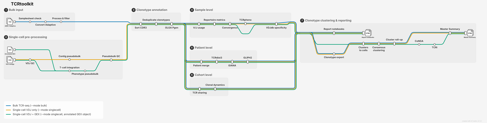

# TCRtoolkit: A T Cell Repertoire Analysis Platform


Thanks for checking out `TCRtoolkit`, the platform for T Cell Repertoire analysis! `TCRtoolkit` is wrapped in Nextflow, written in python, and uses Docker to manage dependencies.

<p align="center">
    
</p>

We support two modalities:

- **Bulk TCR sequencing** in AIRR or Adaptive Biotechnologies format (`--mode bulk`, the default).
- **Single-cell TCR sequencing** from Cell Ranger VDJ output (`--mode singlecell`), optionally with an annotated gene-expression (GEX) Seurat object. Cells are pooled into per-sample pseudobulk repertoires that run through the same analysis engine as bulk data, and the GEX object adds cell-state analyses (CoNGA, TCRi, cell states of clones).

##  Requirements

1. Nextflow

Nextflow can be used on any POSIX-compatible system (Linux, OS X, WSL). It requires Bash 3.2 (or later) and Java 11 (or later, up to 18) to be installed.

```bash
wget -qO- https://get.nextflow.io | bash
chmod +x nextflow
```

The nextflow executable is now available to run on the command line. The executable can be moved to a directory in your $PATH variable so you can run it from any directory.

2. Docker

`TCRtoolkit` runs in Docker containers available at [GHCR](https://github.com/KarchinLab/TCRtoolkit/pkgs/container/tcrtoolkit) (`--container`, default `ghcr.io/karchinlab/tcrtoolkit:main`). Cell-level single-cell steps use a second image (`--sc_container`, default `syedsazaidi/scratch-tcr:latest`). Depending on what operating system you are running (Linux, MacOS, WSL), please refer to the [Docker documentation](https://docs.docker.com/engine/install/) for installation instructions.

On HPC systems without Docker, the same images run under Singularity/Apptainer: pass a config with `-c` that sets `docker.enabled = false` and `singularity.enabled = true` (plus your executor settings).

## Quick Start

Below is a minimal example of how to run the pipeline. The `minimal-example` dataset provided is a small subset of the dataset from this manuscript by [Tumeh and Ribas et al. (2014)](https://www.nature.com/articles/nature13954). Note that the results are simply for demonstration purposes and are not intended for biological interpretation.

Supply non-default parameters in `params.yml` rather than on the command line, so that number- and boolean-type parameters are not read as strings (see [Nextflow strict syntax](https://docs.seqera.io/nextflow/strict-syntax#using-legacy-parameter-declarations)).

```bash
nextflow run KarchinLab/TCRtoolkit \
    -params-file params.yml
```

A minimal bulk `params.yml` (the repository's `params.yml` runs the `minimal-example` data):

```yaml
samplesheet: "tests/test_data/minimal-example/samplesheet.csv"
input_format: "adaptive"
outdir: "out"
run_patient: true        # sample and compare run by default
```

A single-cell run (see `params_singlecell.yml` for a commented template):

```yaml
mode: singlecell
input_vdj_contigs: "cellranger/*/outs"        # Cell Ranger VDJ outputs
sample_sheet: "sc_samplesheet.csv"
input_annotated_object: "annotated_tcells.rds" # optional: enables the GEX analyses
outdir: "out_singlecell"
```
> [!IMPORTANT]
> If having an error similar to `qemu: uncaught target signal 11 (Segmentation fault) - core dumped` (observed on Mac OS Tahoe i.e. `26.5.1`), rebuild the Docker container locally, using the provided Dockerfile, and use that in the params, e.g. `--container <my image>`. It features arch selectors to pick the right `quarto` installation.

## Inputs

### Bulk (`--mode bulk`, default)

`--samplesheet` is a CSV with one row per sample:

| Column | Required | Description |
|---|---|---|
| `sample` | yes | Sample ID |
| `file` | yes | Path or URL to the sample's TCR table |
| `patient` | for `run_patient` | Patient ID; groups samples for patient-level clustering and per-patient report tabs |
| `timepoint`, `origin` | recommended | Timepoint and compartment (e.g. `tumor`, `blood`), used by clonal dynamics and the reports |
| `alias` | optional | Short label shown in the reports instead of the sample ID |

`--input_format` sets the format of the TCR tables:

| Format | Description |
|---|---|
| `airr` | AIRR-compliant tab-separated files (default) |
| `adaptive` | Adaptive Biotechnologies output files |

### Single-cell (`--mode singlecell`)

| Parameter | Description |
|---|---|
| `--input_vdj_contigs` | Cell Ranger VDJ outputs (`filtered_contig_annotations.csv`, `clonotypes.csv`), e.g. `cellranger/*/outs` |
| `--sample_sheet` | CSV with `sample` and `path` (the sample's Cell Ranger folder), plus optional `patient_id`, `timepoint`, `origin`, `alias` and any extra metadata columns. Note: a different parameter from the bulk `--samplesheet` |
| `--input_annotated_object` | Optional annotated GEX Seurat object (RDS). With it, the run takes the **VDJ+GEX route** (CoNGA, TCRi, cell-state analyses); without it, the **VDJ-only route** |

Cells are pooled per sample into pseudobulk repertoires (`--pseudobulk_by_phenotype` pools per sample and cell type instead); units with too few clones or cells (`--pseudobulk_qc_min_clones`, `--pseudobulk_qc_min_cells`) are dropped or stop the run (`--pseudobulk_qc_mode`). Timepoints are ordered numerically or alphabetically unless `--timepoint_order` gives the order (e.g. `"d0,d14,d28"`).

## Workflow Levels

Bulk runs are split into analysis stages, each switched on or off with its own flag:

| Flag | Default | Stage |
|---|---|---|
| `run_sample` | `true` | Per-sample QC and repertoire statistics |
| `run_compare` | `true` | Cross-sample repertoire comparison, overlap and clonal dynamics |
| `run_patient` | `false` | Patient-level clonotype clustering: GIANA, GLIPH2 (`--use_gliph2`) and TCRdist3, each over all of a patient's samples (needs a `patient` column) |
| `run_convert` | `false` | Convert Adaptive tables to AIRR (`--input_format adaptive`) |

Single-cell runs always run all three analysis stages (sample, patient and compare).

## HTML Reports
 
After the pipeline finishes, `TCRtoolkit` generates interactive HTML reports using [Quarto](https://quarto.org/) (disable with `--run_reports false`). Report notebooks are rendered automatically depending on which stages ran:
 
| Notebook | Rendered when | Description |
|---|---|---|
| `template_qc.qmd` (**QC & Run Info**) | sample | Run overview, sample statistics, diversity, overlap, productivity (computed before QC filtering), CDR3 length, richness and depth, V-gene PCA and outliers; chain-level checks show TRA and TRB for single-cell data and TRB for bulk. Single-cell runs add VDJ QC, chain pairing, receptor-to-GEX matching and the pseudobulk gate |
| `template_details_sample.qmd` | sample | Per-sample repertoire composition, V/J gene usage (TRA and TRB for single-cell, TRB for bulk), generation probability and VDJdb; single-cell runs add clone rank abundance, cell states of clones, CoNGA and TCRi |
| `template_details_compare.qmd` | sample + compare | Clonal dynamics (with the phenotypic fate of persistent clones, blood vs tissue and individual clone tracking for single-cell data, clone sizes over time for bulk), TCR sharing and generation probability, repertoire overlap |
| `template_details_patient.qmd` | sample + patient | TCR sequence clustering: GIANA, GLIPH2 (`--use_gliph2`) and TCRdist3 (clusters and within-sample distance distributions), their comparison, and the consensus clusters; single-cell runs add clustering coverage by cell state and the consensus clusters' samples, cell states, CoNGA and TCRi |
| `Master_Summary_Report.qmd` (**Master Summary**) | clonotype clustering ran (`--run_master_summary`) | Highest-impact repertoire findings (the Discovery Brief), consensus clustering (all routes) and, with a GEX object, the cell-state analyses: expansion and clonal dynamics by cell state, CoNGA, TCRi, T-cell integration |

Each report is published to its own folder under `<outdir>/report/`:

```
<outdir>/report/
├── template_qc/template_qc.html
├── template_details_sample/template_details_sample.html
├── template_details_compare/template_details_compare.html
├── template_details_patient/template_details_patient.html
└── master_summary/
    ├── Master_Summary_Report.html
    ├── Master_Summary_Report/tables/   # TSV of every table in the report
    └── SC_GEX_Report.html              # VDJ+GEX route only: the GEX section on its own
```

 
### Conditional Report Sections
 
Certain sub-reports are automatically appended based on input and workflow options:
 
- TCRpheno (phenotype predicted from the TCR β sequence) runs on bulk data and the single-cell VDJ-only route, and its section is added to the Discovery Brief (in the Master Summary). It is skipped on the single-cell VDJ+GEX route, where the GEX object gives each cell's measured phenotype.
- The TCRdist3 distance plots (Patient details) read each sample's block of its patient's TCRdist3 matrix, so they need the patient stage (`run_patient: true` on bulk; always on for single-cell).
- `run_sample` and `run_patient` → renders `template_details_patient.qmd` (patient-level clonotype analysis)
- `--use_gliph2` (default `true`) → includes GLIPH2 clustering in the patient details report; set it to `false` to skip GLIPH2
- `--mode singlecell` → the same notebooks are rendered, each with a single-cell section (`notebooks/_sc_*.qmd`): VDJ / GEX-matching QC, cell states of clones with CoNGA and TCRi, the phenotypic fate of persistent clones, blood vs tissue and clone tracking (inside Clonal dynamics), and cell-level consensus clusters with clustering coverage by cell state. On bulk data the compare report gets the clone-size counterpart (`notebooks/_bulk_details_compare.qmd`). The report samplesheet is built from `--sample_sheet` (`patient_id`, `timepoint`, `origin`/`tissue` columns).

### Repertoire metrics (both modalities)

Diversity, clone-size bins, overlap and clone sharing are computed once, by `REPERTOIRE_METRICS` (`bin/repertoire_metrics.py`) in the `sample` stage, and every report notebook and the Master Summary reads its tables:

| Output | Contents |
|---|---|
| `sample/sample_stats.csv` | Per-sample stats with diversity: `num_clones`, `num_TCRs`, `clonality`, `simpson_index[_corrected]`, `shannon_entropy`, `inverse_simpson`, `gini_coefficient`, `hill_q0`–`hill_q2`, `clone_unit` |
| `repertoire/diversity_by_group.tsv` | The same metrics on clones pooled per patient / condition / timepoint / origin |
| `repertoire/clone_size_bins.tsv` | Clones and TCRs per frequency bin (`--clone_bin_breaks`, `--clone_bin_labels`) |
| `repertoire/overlap_samples.tsv` | Every sample pair: shared clones, Jaccard, Sørensen, Morisita-Horn (within-patient pairs included) |
| `repertoire/overlap_patients.tsv` | Every patient pair (clones pooled per patient): shared clones, Jaccard |
| `repertoire/clone_sharing.tsv` | Per clone: samples, patients, conditions and timepoints it occurs in |
| `repertoire/repertoire_summary.tsv` | Cohort rollup |

The clone unit depends on the modality: bulk counts TRB clonotypes (reads/templates), and single-cell counts paired clones (`A:<CDR3a>|B:<CDR3b>`, cells), taken from `paired_clones.tsv` written by the route's bridge (`SC_TO_CDR3` or `VDJ_TO_BULK`), which define the clone identically. The public-clone analysis in `tcrsharing` uses TRB CDR3 because generation probability (OLGA) is defined per CDR3.

### Clonotype clustering and Master Summary (both modalities)

After the cohort comparison, both modalities run the same chain: a per-cell (single-cell) or per-clonotype (bulk) export → `CLUSTER_TO_SC` (GIANA / GLIPH2 / TCRdist3 clusters mapped onto those rows) → `CONSENSUS_CLUSTERING` → `CLUSTER_ROLLUP` → `MASTER_SUMMARY`. Without a GEX object these steps run on the export table alone. Bulk runs need `run_compare` plus `run_sample` and/or `run_patient`; disable with `--run_clonotype_clustering false`.

All three methods cluster per patient, over all of that patient's samples, and their clusters are mapped onto the rows of that patient only (matched on patient and CDR3β). TCRdist3 clusters are the connected components of the patient's distance matrix at `--tcrdist_radius`, with at least two distinct CDR3β. On the single-cell VDJ+GEX route CoNGA runs before the consensus and is a fourth method: each CoNGA hit clonotype (score < 1) is labelled by its (GEX cluster, TCR cluster) pair. Because the methods label clusters independently, the consensus does not compare labels: two clonotypes are linked when at least `--consensus_min_methods` methods (default 2) place them in the same cluster, and each connected group of linked clonotypes is one consensus cluster. `consensus_cluster_map.tsv` lists, per consensus cluster, its clonotypes, cells, the methods whose agreement built it (`consensus_methods`) and the member clusters of each method.

With a GEX object (`--input_annotated_object`), `MASTER_SUMMARY` also renders `SC_GEX_Report.html` from `modules/scratch/MASTER_SUMMARY/_sc_gex.qmd` (cell-state map, composition by sample and condition, expansion and clone sharing by cell state, marker-gene expression of expanded cells, CoNGA, TCRi and consensus clusters by cell state), and the same section is appended to the Master Summary. Other routes get a short stub in its place.

## Key Parameters

All parameters and their defaults are in `nextflow.config`. Supply non-default values in `params.yml`.

**General**

| Parameter | Default | Description |
|---|---|---|
| `--mode` | `bulk` | Modality: `bulk` or `singlecell` |
| `--outdir` | `out` | Output directory |
| `--project_name` | `tcrtoolkit_<date>` | Run name used in the Master Summary |
| `--run_sample` / `--run_compare` / `--run_patient` | `true` / `true` / `false` | Analysis stages (bulk; see Workflow Levels) |
| `--use_gliph2` | `true` | GLIPH2 CDR3 motif clustering |
| `--run_reports` | `true` | Render the HTML report notebooks |
| `--run_clonotype_clustering` | `true` | Cluster-to-row mapping, consensus clustering and rollups |
| `--consensus_min_methods` | `2` | Methods that must agree to link two clonotypes in a consensus cluster |
| `--tcrdist_radius` | `24` | TCRdist3 distance radius for clusters |
| `--run_master_summary` | `true` | Render the Master Summary |
| `--timepoint_order` | — | Comma-separated timepoint order for the reports (default: numeric, else alphabetical) |
| `--container` | `ghcr.io/karchinlab/tcrtoolkit:main` | Main container image |
| `--max_memory` / `--max_cpus` / `--max_time` | `768.GB` / `192` / `48.h` | Resource caps |

**Bulk**

| Parameter | Default | Description |
|---|---|---|
| `--samplesheet` | — | Path or URL to the sample sheet CSV |
| `--input_format` | `airr` | `airr` or `adaptive` |

**Single-cell**

| Parameter | Default | Description |
|---|---|---|
| `--input_vdj_contigs` | — | Cell Ranger VDJ outputs |
| `--sample_sheet` | — | Single-cell sample sheet (`sample`, `path`, …) |
| `--input_annotated_object` | — | Optional annotated GEX Seurat RDS (selects the VDJ+GEX route) |
| `--label_col` | — | Cell-state column of the GEX object (auto-detected from common names when unset) |
| `--subset_tcells` | `true` | Keep only GEX cells whose label matches `--tcell_regex` (set `false` if every cell is a T cell) |
| `--pseudobulk_by_phenotype` | `false` | Pool cells per sample and cell type instead of per sample |
| `--pseudobulk_qc_min_clones` / `--pseudobulk_qc_min_cells` | `25` / `50` | Pseudobulk QC gate |
| `--pseudobulk_qc_mode` | `drop` | `drop` failing units or `hard_stop` the run |
| `--run_conga` / `--run_tcri` | `true` / `true` | CoNGA and TCRi (VDJ+GEX route) |
| `--sc_container` | `syedsazaidi/scratch-tcr:latest` | Container for the cell-level single-cell steps |
